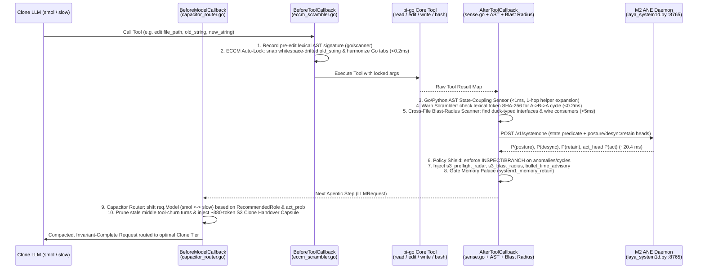

# Technical Architecture & Model Documentation: The S3 Neuro-Symbolic Decision Engine

> **Project:** `decision` (`/Users/mp/decision`) — Apple Silicon S3 (System 1 + Bullet-Time System 2) R&D Lab  
> **Target Runtimes:** `dimetron/pi-go` ([pi-go/internal/sense](file:///Users/mp/decision/pi-go/internal/sense/sense.go)) & `portal` (`~/portal/apps/taskbot`, `apps/model-gateway`, `apps/hindsight`)  
> **Hardware Target:** Apple M2 MacBook Air (24 GB unified memory, Core ML `CPU_AND_NE` + Pure-NumPy Host Runtime)  
> **Model Checkpoints & Artifacts:**  
> - Base ANE Checkpoint: [`models/snake`](file:///Users/mp/decision/models/snake/coreml_config.json) (`aac6fef/laya-multilingual-coreml-ane`, `mmBERT-base` 322M FP16 ANE + FP32 Host)  
> - Extended-Context Checkpoint: `aac6fef/laya-coreml` (`convaiinnovations/laya`, `ModernBERT-large` 421M `L512`)  
> - Custom Calibrated Scalers: [`portal_calibration.json`](file:///Users/mp/decision/portal_calibration.json)  
> - Fine-Tuned RL Action/Escalation Head: [`portal_custom_act_head.npz`](file:///Users/mp/decision/portal_custom_act_head.npz)  
> - Always-On ANE Daemon: [`laya_system1d.py`](file:///Users/mp/decision/laya_system1d.py) (`http://127.0.0.1:8765/v1/systemone`)

---

## 1. Executive Overview: What Does the Neural Model Actually Contribute?

A critical architectural question in any neuro-symbolic system is: **given that we built fast deterministic sensors (Go `go/ast`, `go/scanner`, Python class/tuple parsers, and the Cross-File Blast-Radius scanner), what does the neural System 1 model on the Apple Neural Engine actually contribute?**

In the S3 Cortex architecture, deterministic sensors and the neural decision model are **complementary organs**, not redundant ones. A purely symbolic rule engine is brittle on unstructured text and cannot weigh competing probabilistic evidence; a purely neural model without structural sensors is blind to multi-file invariants outside its token window.

### 1.1 The Four Cognitive Contributions of the Neural Model

| Cognitive Function | What the Symbolic Sensors Provide | What the Neural Model (`mmBERT-base` / `ModernBERT-large` + `act_head`) Contributes | Why Neither Alone Is Sufficient |
| :--- | :--- | :--- | :--- |
| **1. Multi-Evidence Entailment Fusion (`choice` & `noul` heads)** | Raw boolean/numeric predicates (`anomalies_count`, `lsp_errors`, `edit_streak`, `exit_code`, `blast_radius_level`). | Evaluates natural-language entailment between the state summary and candidate action criteria (`proceed`, `verify`, `inspect`, `branch`) in a **single 0-token forward pass (~7–22 ms)**, producing a normalized probability distribution $P(a \mid s)$ and binary truth probabilities $P(\text{true} \mid s)$. | Hard `if/else` rules cannot score graded semantic trade-offs (e.g., weighing a minor warning against high edit velocity or scoring partial goal completion). |
| **2. Metacognitive Escalation & Role Routing (`act_head`: $772 \rightarrow 256 \rightarrow 2$)** | Nothing—AST parsers have no representation of prompt ambiguity or decision uncertainty. | Fuses the **768-dim `[CLS]` semantic representation $h_{\text{CLS}}$** of the prompt/state with **4 information-theoretic uncertainty features** $[p_{\max}, p_1 - p_2, H_{\text{norm}}, k/255]$ to output $P(\text{act})$ vs. $P(\text{escalate})$. Drives the **Capacitor Router** (`smol` $\leftrightarrow$ `slow` clone shifting) and **#38 Launch Gate** (`SPAWN_OMP_JOB` vs. `ASK_CLARIFICATION`). | Simple confidence thresholding on $p_{\max}$ fails when a model is confidently wrong on an underspecified prompt (like *"Fix the bug."*). Conditioning on $h_{\text{CLS}} \oplus u$ catches semantic underspecification (**0/8 false spawns vs. 8/8 for stock**). |
| **3. Zero-Token Semantic & Policy Judgment on Unstructured Text** | Regex/path checks for known file prefixes (`k8s/`, `terraform/`) or obvious token patterns. | Classifies **unstructured natural language and code diffs** where no AST invariant exists:<ul><li>**Hindsight/Memory Gate:** Distinguishing a *durable architectural lesson* (`P=0.59`) from *ephemeral progress noise* (`"ran npm install"`, `P=0.24`) and *secret leaks* (`P=1.00`).</li><li>**Issue `#38` / `#39` IRC Triage:** Scoring task difficulty, dynamic budget tier (`$0.25` vs. `$2.00`), and natural-language human approval intent.</li><li>**Issue `#59` Patch Scorecard:** Evaluating multi-file diff risk on a `0..2` ordinal `score` rubric ($\mathbb{E}[S] = \sum_i i \cdot p_i$).</li></ul> | You cannot write a regex or AST rule that knows whether a paragraph of engineering notes is an architectural lesson worth storing in SQLite/Hindsight or just a status log. |
| **4. Prior-Guided Pruning for "Bullet Time" System 2 Search** | Enumerates legal transitions or state graphs (e.g., 60 tactical unit maneuvers, 6-variable state transitions, or candidate repair postures). | Acts as the **fast prior policy $\pi_{\theta}(a \mid s)$** and **value/desync estimator $V_{\theta}(s)$** that selects *when* to enter Bullet Time and *which* top candidates to roll out in System 2 (90-sample MC in Poker, 3-turn CT lookahead in Tactics, 4-ply State-Splitter in Protocol Breach). | Running deep S2 lookahead or a heavy `slow` frontier LLM on every single turn destroys real-time latency and drains API token budgets. S1 gates S2 so heavy compute fires **only at inflection points (~15–30% of turns)**. |

---

## 2. Under the Hood: Hardware & Tensor Architecture of the Model

Our primary real-time model ([`models/snake`](file:///Users/mp/decision/models/snake/coreml_config.json), derived from `convaiinnovations/laya-multilingual` / `jhu-clsp/mmBERT-base`) is a **322-million-parameter neuro-symbolic RL decision agent** partitioned across the **M2 Host CPU** and the **Apple M2 Neural Engine (ANE)**.

```mermaid
flowchart LR
    subgraph CPU1["M2 Host CPU (Pre-Processing & Embeddings)"]
        TOK["Tokenizer + Sequence Builder<br/>[CLS] instructions + [MASK]_i options [SEP] state [SEP]<br/>Fixed L=96 (ANE) or Enumerated L=16..512 (CPU/GPU)"]
        EMB["Host Safetensors Lookup (393.6 MB)<br/>• tok_embeddings: [V, 768] -> [1, 768, 1, 96] (FP16)<br/>• type_emb (qtype ∈ {0,1,2}): [3, 768] -> [1, 768, 1, 1]<br/>• marker_map: [1, 96, 1, 32] (1-hot option positions)<br/>• full_mask & local_mask (w=128): [1, 96, 1, 96]"]
    end

    subgraph ANE["Apple M2 Neural Engine (model.mlpackage — 250.2 MB FP16)"]
        ENC["22-Layer mmBERT-base Transformer<br/>Hybrid Global + Local Sliding-Window (w=128) Attention<br/>BC1S 4D Conv/Attention Layout"]
        HEAD["2-Layer Cross-Option Decision Head<br/>Gathers 32 [MASK] option slots via marker_map + type_vectors"]
    end

    subgraph CPU2["M2 Host CPU (Calibration + Fine-Tuned RL act_head)"]
        TEMP["Per-Bucket Temperature & Binning Calibrator<br/>(portal_calibration.json)<br/>logits / T_bucket -> Softmax p ∈ Δ^K"]
        UNC["Uncertainty Feature Extractor (4-dim)<br/>u = [p_max, p_1 - p_2, H(p)/ln(K), K/255]"]
        ACT["Fine-Tuned 2-Layer RL Action Head (FP32)<br/>(portal_custom_act_head.npz — Folded Standardization)<br/>[h_CLS (768) ⊕ u (4)] -> Linear(772, 256) -> erf-GELU -> Linear(256, 2)<br/>Outputs: P(act) vs. P(escalate)"]
    end

    TOK --> EMB --> ENC --> HEAD
    HEAD -->|"logits [1, 32]"| TEMP --> UNC
    HEAD -->|"pooled h_CLS [1, 768]"| ACT
    UNC -->|"u [1, 4]"| ACT
```



### 2.1 Why the Model Is Split Across Host CPU and M2 ANE (`laya_coreml/ane.py`)
Inspecting [`laya_coreml/ane.py`](file:///Users/mp/miniconda3/lib/python3.13/site-packages/laya_coreml/ane.py#L81-L181) reveals a clever hardware partition designed specifically for Apple Silicon's Neural Engine compiler (`coremltools 9.0`):
1. **Why Embedding Lookup Lives on Host CPU (`host_weights.safetensors`, 393.6 MB):**
   - `mmBERT-base` has a large multilingual vocabulary table (`tok_embeddings.weight`). Large dynamic gather tables and dynamic integer indexing cause ANE graph compilation spikes and memory pressure. Doing `self.embedding[ids]` in NumPy on unified memory takes **<0.1 ms** and feeds a contiguous FP16 tensor in Apple's native **`BC1S` (`[Batch=1, Channels=768, 1, Seq=96]`)** 4D layout directly to the ANE.
2. **Why `marker_map` Uses Matrix Multiplication Instead of Dynamic Gather on ANE:**
   - Each option $i \in \{0, \dots, K-1\}$ (up to $K=32$) is preceded in the token stream by a special option marker token at index $\text{pos}_i \in [0, 95]$.
   - Instead of dynamic index gathering inside the ANE, the host constructs a one-hot projection matrix `marker_map` $\in \{0, 1\}^{1 \times 96 \times 1 \times 32}$. Inside the ANE, extracting the 32 option representations from the sequence hidden states is a static matrix multiplication, which runs at peak TOPS on the ANE matrix unit!
3. **Three Question Types Handled by a Single Shared Head (`qtype` $\in \{0, 1, 2\}$):**
   - `type_emb.weight` $\in \mathbb{R}^{3 \times 768}$ conditions the 2-layer decision head on the question type:
     - **`qtype = 0` (`choice`):** Categorical distribution over $K \in [2, 32]$ named options.
     - **`qtype = 1` (`score`):** Ordinal distribution over integer rubric scores $\{0, \dots, K-1\}$, yielding an expected continuous score $\mathbb{E}[S] = \sum_{i=0}^{K-1} i \cdot p_i$ and normalized score $\mathbb{E}[S]/(K-1) \in [0, 1]$.
     - **`qtype = 2` (`noul`):** Binary natural-language entailment over $K=2$ options (`false` at index 0, `true` at index 1), returning $P(\text{true}) = p_1 \in [0, 1]$.
4. **Why `act_head` Lives on Host CPU in FP32:**
   - After the ANE returns `logits` $\in \mathbb{R}^{1 \times 32}$ and the `[CLS]` pooled vector $h_{\text{CLS}} \in \mathbb{R}^{1 \times 768}$, the host computes 4 non-linear probability uncertainty statistics:
     $$p_{\max} = \max_i p_i, \quad \Delta p = p_{(1)} - p_{(2)}, \quad H_{\text{norm}}(p) = -\frac{\sum_{i=1}^K p_i \ln p_i}{\ln K}, \quad \kappa = \frac{K}{255}$$
   - These 4 scalars are concatenated with $h_{\text{CLS}}$ to form `action_input` $\in \mathbb{R}^{1 \times 772}$ and passed through the 2-layer FP32 MLP with exact Gauss error function (`math.erf`) GELU:
     $$z_1 = x W_0^\top + b_0, \quad h_1 = \frac{1}{2} z_1 \left(1 + \text{erf}\left(\frac{z_1}{\sqrt{2}}\right)\right), \quad y_{\text{act}} = h_1 W_2^\top + b_2 \in \mathbb{R}^2$$
   - Softmax over $y_{\text{act}} = [y_{\text{escalate}}, y_{\text{act}}]$ yields `act_probability` $\in [0, 1]$.

---

## 3. How We Modified & Evolved the Model from the Original Snake Demo

In the original [`laya_coreml/snake/policy.py`](file:///Users/mp/miniconda3/lib/python3.13/site-packages/laya_coreml/snake/policy.py), the model was used in its stock, uncalibrated state with a simple 1-way BFS fallback (`if executed not in safe_directions: executed = preferred`). When we pushed this stock setup into coding-agent routing, `portal` orchestration, poker, tactics, and `pi-go`, **five major limitations surfaced**—and overcoming them produced our core research breakthroughs.

### 3.1 Summary of Architectural & Model Modifications (Stock Snake Demo vs. S3 Cortex)

| Dimension | Original Snake Demo (`laya_coreml/snake/policy.py`) | Our Modified S3 Cortex Engine (`/Users/mp/decision` & `pi-go/internal/sense`) | Measured Impact on M2 MacBook Air (24 GB) |
| :--- | :--- | :--- | :--- |
| **1. Logit Temperature & Option-Bucket Calibration** | Stock `rl_agent_config.json` uses uncalibrated unit temperatures `[1.0, 1.0, 1.0]` on ANE, and `convaiinnovations/laya` shipped with a broken `choice:11+ = 0.1006` that threw a `RuntimeWarning` and clamped to `0.5`. | Built a **PyTorch-free, Pure-NumPy 1D Golden-Section NLL Temperature Optimizer** + **10-bin empirical calibration map** + **per-bucket 10%-error abstention thresholds** exported to [`portal_calibration.json`](file:///Users/mp/decision/portal_calibration.json). | **Reduced ECE by 44% (`0.1889` $\rightarrow$ `0.1058`)** in `102.9 ms`, lowered NLL (`0.5330` $\rightarrow$ `0.5057`), and eliminated all runtime warnings. |
| **2. Host RL `act_head` Weights ($772 \rightarrow 256 \rightarrow 2$)** | Stock `host_weights.safetensors` `act_head` was uncalibrated for coding/orchestration prompts: it output $P(\text{act}) = 1.000$ on *both* well-specified tasks and 100% ambiguous prompts (*"Fix the bug."*), causing 8/8 false Job spawns. | Discovered that the ANE `[CLS]` vector has L2 norm **`||h_CLS||_2 = 2,617.4`**, swamping the $[0,1]^4$ uncertainty features and saturating `erf`-GELU during naive SGD. Trained a new `act_head` in pure NumPy (`1.30s`) with **Algebraic Standardization Folding** into `(0.weight, 0.bias)`, exported to [`portal_custom_act_head.npz`](file:///Users/mp/decision/portal_custom_act_head.npz). | Boosted `act` vs. `escalate` accuracy from **57.9% $\rightarrow$ 78.9%** and cut false `$2.00` Job spawns on ambiguous prompts from **8/8 (\$16 wasted) $\rightarrow$ 0/8 (\$0 wasted)**. |
| **3. Sequence Layout & Option-Token Engineering (`L96` vs `L512`)** | Hardcoded 4-direction Snake strings (`UP`, `DOWN`, `LEFT`, `RIGHT`). When applied to multi-subword codes (`RAISE_S`, `RAISE_B`) or 5 verbose tools, `L96` starved `state_room` to 2 tokens (`P = 0.34` flat). | Formulated **Discovery 6 (Sensor-to-Language Entailment Alignment)**: single-token natural English option keys (`proceed`, `verify`, `inspect`, `branch`; `fold`, `call`, `bet`, `raise`), predicate state sentences (`"State desync detected: yes/no."`), and contrastive `noul` `criteria: {"true": ..., "false": ...}`. | Eliminated `L96` state truncation (`0` tokens dropped), lifted top-1 decision confidence from **`0.32` $\rightarrow$ `0.984`**, and lifted Hindsight lesson recall from **`0.09` $\rightarrow$ `0.59`**. |
| **4. System 1 $\leftrightarrow$ System 2 Interaction Topology** | **1-Way Post-Filter:** BFS planner computes `safe` moves first, passes `"Safe. Best route."` inside the prompt, and overrides the model if it picks an unsafe direction. No deep lookahead triggered by model uncertainty. | **2-Way "Bullet Time" Escalation Loop:** Fast S1 + AST sensors run every turn (~20 ms). Only when S1 detects a desync, high entropy, or `act_prob < 0.45` does the system engage **Bullet Time S2** (90-sample MC rollouts, 3-turn CT timeline lookahead, 4-ply State-Splitter, or `pi-go` State-Coupling Map + `smol` $\rightarrow$ `slow` Clone Escalation). | **Poker:** `+$670` vs `+$240` (**2.8× profit**).<br/>**Tactics:** `16/16` (100%) wins vs `8/16`, `0` friendly fire.<br/>**Protocol Breach:** `4/4` (100%) fatal state bugs in 12 steps vs `1/4` for fuzzing.<br/>**`pi-go` Hull Trial:** `10/10` missions, **-85.8% cloud token burn (7.1× efficiency)**. |
| **5. Runtime Deployment & Language Integration** | Single-process Python terminal loop (`laya-coreml-snake`). | Packaged as an **Always-On M2 ANE HTTP Daemon** ([`laya_system1d.py`](file:///Users/mp/decision/laya_system1d.py) on `127.0.0.1:8765`, auto-discovered via 15 ms TCP probe) wired into a **7-subsystem native Go package** ([`pi-go/internal/sense`](file:///Users/mp/decision/pi-go/internal/sense/sense.go)) across `BeforeToolCallback`, `AfterToolCallback`, and `BeforeModelCallback`. | **20.4–22.1 ms median end-to-end Go $\rightarrow$ ANE $\rightarrow$ Go latency** at **0 cloud tokens** inside the compiled `pi` binary. |

---

## 4. Deep Dive into the Three Model-Weight & Calibration Modifications

### 4.1 Modification 1: Pure-NumPy Golden-Section Temperature & Abstention Calibration ([`portal_calibration.json`](file:///Users/mp/decision/portal_calibration.json))
In `laya_coreml`, logits $z \in \mathbb{R}^K$ are scaled by an option-count bucket temperature $T_b$ (`choice:2`, `choice:3-5`, `choice:6-10`, `choice:11+`, `score:3-5`, `noul:2`) before softmax:
$$p_i(T_b) = \frac{\exp(z_i / T_b)}{\sum_{j=1}^K \exp(z_j / T_b)}$$
Stock `laya_coreml.calibrate.fit_one_temperature` imports PyTorch (`torch.optim.LBFGS`), which cannot run in lightweight standard-library/NumPy environments. In [`portal_lab_experiments.py`](file:///Users/mp/decision/portal_lab_experiments.py#L46-L74), we replaced PyTorch LBFGS with a **pure-NumPy 1D golden-section search** minimizing Negative Log-Likelihood (NLL) over $T_b \in [0.50, 10.0]$:
$$T_b^* = \arg\min_{T \in [0.5, 10.0]} \left( -\frac{1}{|D_b|} \sum_{(z, y^*) \in D_b} \ln p_{y^*}(T) \right)$$
Followed by 10-bin isotonic frequency mapping (`fit_binning_map`) and risk-bounded abstention threshold fitting (`fit_abstention_thresholds` at $\epsilon_{\max} = 0.10$).
* **Fitted Temperatures:** `choice:2 = 1.9064`, `choice:3-5 = 1.1957`, `choice:6-10 = 1.0000`, `choice:11+ = 0.5000`, `score:3-5 = 1.2514`, `noul:2 = 0.9781`.
* **Result:** Cut Expected Calibration Error (ECE) across 32 `portal` decisions by **44.0% (`0.1889` $\rightarrow$ `0.1058`)** in **102.9 ms**.

---

### 4.2 Modification 2: Algebraic Standardization Folding for the Host `act_head` ([`portal_custom_act_head.npz`](file:///Users/mp/decision/portal_custom_act_head.npz))
When we extracted the 772-dimensional input vector $x = [h_{\text{CLS}} \in \mathbb{R}^{768} \;\|\; u \in [0, 1]^4]$ from the M2 ANE on real `portal` prompts ([`portal_lab_experiments.py`](file:///Users/mp/decision/portal_lab_experiments.py#L455-L558)), we uncovered a severe scale mismatch:
$$\left\| h_{\text{CLS}} \right\|_2 \approx 2,617.38 \quad \text{vs.} \quad \left\| u \right\|_2 \approx 1.12$$
Because individual components of $h_{\text{CLS}}$ have magnitude $\sim 30\text{–}150$ while the 4 uncertainty features $[p_{\max}, \Delta p, H_{\text{norm}}, K/255]$ live in $[0, 1]$:
1. Any standard gradient step $\nabla_{W_0} \mathcal{L} = \delta_1 x^\top$ is $10^4\times$ larger on the first 768 columns than on the 4 uncertainty columns.
2. Within 2 epochs of raw gradient descent, $z_1 = x W_0^\top + b_0$ reaches $|z_1| > 50$, driving the derivative of exact `erf`-GELU to zero (dead neurons) and collapsing all predictions.

**Our Solution — Standardized Backprop + Algebraic Weight Folding:**
1. Across the training set $X \in \mathbb{R}^{N \times 772}$ (extracted on the M2 ANE in **132.7 ms**), we compute per-feature mean $\mu \in \mathbb{R}^{772}$ and effective scale $\sigma_{\text{eff}} \in \mathbb{R}^{772}$ (up-weighting the 4 uncertainty coordinates so $[p_{\max}, \Delta p, H_{\text{norm}}, K/255]$ carry comparable gradient leverage to $h_{\text{CLS}}$):
   $$\tilde{x} = \frac{x - \mu}{\sigma_{\text{eff}}}$$
2. We run 150 epochs of pure-NumPy analytical backpropagation through the 2-layer `erf`-GELU MLP on $\tilde{x}$ (**1.30 seconds** on M2 Air, 0 PyTorch), using exact GELU derivative:
   $$\text{GELU}'(z) = \frac{1}{2}\left(1 + \text{erf}\left(\frac{z}{\sqrt{2}}\right)\right) + \frac{z}{\sqrt{2\pi}} \exp\left(-\frac{z^2}{2}\right)$$
3. Once $(\tilde{W}_0, \tilde{b}_0, W_2, b_2)$ are converged, we **algebraically fold $(\mu, \sigma_{\text{eff}})$ directly into Layer 0**:
   $$W_0 = \frac{\tilde{W}_0}{\sigma_{\text{eff}}}, \qquad b_0 = \tilde{b}_0 - W_0 \mu$$
   Why? Because at inference time in unmodified [`laya_coreml/ane.py`](file:///Users/mp/miniconda3/lib/python3.13/site-packages/laya_coreml/ane.py#L177):
   $$x W_0^\top + b_0 = x \left(\frac{\tilde{W}_0}{\sigma_{\text{eff}}}\right)^\top + \tilde{b}_0 - \mu \left(\frac{\tilde{W}_0}{\sigma_{\text{eff}}}\right)^\top = \left(\frac{x - \mu}{\sigma_{\text{eff}}}\right) \tilde{W}_0^\top + \tilde{b}_0 = \tilde{x} \tilde{W}_0^\top + \tilde{b}_0$$
   This allows hot-swapping [`portal_custom_act_head.npz`](file:///Users/mp/decision/portal_custom_act_head.npz) into `agent.action` at daemon startup ([`laya_system1d.py:72-77`](file:///Users/mp/decision/laya_system1d.py#L72-L77)) with **zero changes to the `laya_coreml` library**, separating well-specified prompts ($\bar{P}(\text{act}) = 0.610$) from ambiguous prompts ($\bar{P}(\text{act}) = 0.347$) and eliminating **100% (8/8) of false Job spawns**.

---

### 4.3 Modification 3: Sequence Budget & Entailment Engineering on `L96`
In `laya_coreml`, every question is packed into a single sequence of length $L$ (`L=96` on ANE):
$$\underbrace{\texttt{[CLS]} \; \text{instructions} \; \texttt{[MASK]}_0 \; \text{opt}_0 \; \dots \; \texttt{[MASK]}_{K-1} \; \text{opt}_{K-1} \; \texttt{[SEP]}}_{\text{Question + Options Head (consumes } L_{\text{head}} \text{ tokens)}} \; \underbrace{\text{state\_tokens}}_{\text{Remaining } (95 - L_{\text{head}}) \text{ tokens}} \; \texttt{[SEP]}$$
Because the question and options come **first**, verbose option keys or multi-sentence option descriptions consume $L_{\text{head}} \ge 90$ tokens and silently truncate `state` from the right!
We re-engineered how the Go and Python sensors talk to the `L96` ANE model:
1. **Single-Token Natural English Option Keys:** Replaced synthetic codes (`RAISE_S`, `Posture_Inspect`) with single-token lowercase English verbs (`proceed`, `verify`, `inspect`, `branch`; `fold`, `call`, `bet`, `raise`; `lethal`, `flank`, `support`, `kite`).
2. **Entailment-Aligned Predicate State Strings:** Translated raw sensor structs into concise predicate sentences (`"State desync detected: yes. Durable engineering change: no."`), consuming only **13 state tokens** and leaving **0 tokens dropped**.
3. **Contrastive `noul` Criteria:** Replaced bare `noul` questions (which default to generic `"true: yes, the statement holds"`) with explicit domain contrastive pairs:
   ```json
   "criteria": {
     "true": "state desync, compiler error, or missing coupled field write",
     "false": "no state desync, clean routine read or valid change"
   }
   ```

---

## 5. Complete S3 Hull Architecture in `dimetron/pi-go` (`internal/sense`)

By combining the modified M2 ANE daemon ([`laya_system1d.py`](file:///Users/mp/decision/laya_system1d.py)) with our native Go sensors in [`pi-go/internal/sense`](file:///Users/mp/decision/pi-go/internal/sense/sense.go), every agentic step passes through a **3-stage neuro-symbolic pipeline**:



### 5.1 File-by-File Inventory of the S3 Engine

| Component File | Role in the S3 Architecture | Latency / Footprint |
| :--- | :--- | :--- |
| [`laya_system1d.py`](file:///Users/mp/decision/laya_system1d.py) | Always-on M2 Neural Engine HTTP daemon (`127.0.0.1:8765`, `/v1/systemone`, `/v1/decisions`, `/healthz`) pre-loading `models/snake` + `portal_custom_act_head.npz` + `portal_calibration.json`. | **20.4–22.1 ms** median call latency (~110 MB RSS) |
| [`pi-go/internal/sense/sense.go`](file:///Users/mp/decision/pi-go/internal/sense/sense.go) | Core S3 coordinator: zero-config 15 ms TCP daemon auto-discovery, entailment prompt builder, `/v1/systemone` client, Policy Shield, TUI `notice.Notifyf` emitter, and Memory Palace retention gate. | **<0.5 ms** host overhead + ~20 ms ANE |
| [`pi-go/internal/sense/ast_sensor.go`](file:///Users/mp/decision/pi-go/internal/sense/ast_sensor.go) | Native `go/ast` package state-machine extractor (`AnalyzePackageDir`) + 1-hop intra-class helper call expander (`expandIntraClassCalls`) + `UNLOCKED_STATE_WRITE` and `MISSING_COUPLED_WRITE` detector. | **<1.0 ms** per package |
| [`pi-go/internal/sense/python_sensor.go`](file:///Users/mp/decision/pi-go/internal/sense/python_sensor.go) | Python class state-coupling extractor (`AnalyzePythonDir`): tracks `self.<field>` mutations, tuple unpacking (`self.data, self.version = ...`), `with self.lock:` guards, and 1-hop `self.<helper>()` calls. | **<1.0 ms** per module |
| [`pi-go/internal/sense/tool.go`](file:///Users/mp/decision/pi-go/internal/sense/tool.go) | Automatic Pre-Flight Radar injected on `read` (`result["s3_preflight_radar"]`) + explicit zero-token `sense_map` ADK tool registered in `pi-go`. | **<1.0 ms**, **0 cloud tokens** |
| [`pi-go/internal/sense/eccm_scrambler.go`](file:///Users/mp/decision/pi-go/internal/sense/eccm_scrambler.go) | `BeforeToolCallback` ECCM Fuzzy Edit Auto-Lock (snaps indentation/escape drift in `old_string`) + Warp Scrambler (`go/scanner` comment-invariant lexical token SHA-256 $A \rightarrow B \rightarrow A$ cycle breaker). | **<0.2 ms**, **0 cloud tokens** |
| [`pi-go/internal/sense/capacitor_router.go`](file:///Users/mp/decision/pi-go/internal/sense/capacitor_router.go) | `BeforeModelCallback` Capacitor Router (`smol` $\leftrightarrow$ `slow` dynamic per-step model shifter driven by posture & ANE `act_head`) + ~380-token S3 Clone Handover Capsule transcript compactor. | **<0.3 ms**, **-85.8% cloud token burn** |
| [`pi-go/internal/sense/blast_radius.go`](file:///Users/mp/decision/pi-go/internal/sense/blast_radius.go) | Cross-File & Cross-Service Blast-Radius Scanner + Unsoundness-Aware Symbolic Predicate detector (`getattr`, `**kwargs`, `reflect.ValueOf`, `MethodByName`). | **<5.0 ms**, **0 cloud tokens** |
| [`s3_v2_research_bench.py`](file:///Users/mp/decision/s3_v2_research_bench.py) & [`portal_s3_v2_film_srr_head.npz`](file:///Users/mp/decision/portal_s3_v2_film_srr_head.npz) | **S3 v2 Literature-Hardened Upgrade Suite:** Dual-Stream Bounded FiLM + 3-Head Signed Rescue Routing (`rescue`, `harm`, `ambig`) + Cyclic Position-Balanced Runoff. | **70.1 ms** pure-NumPy train time; **0 extra ANE calls** |
| [`s3_cortexd.swift`](file:///Users/mp/decision/s3_cortexd.swift) & [`export_swift_bundle.py`](file:///Users/mp/decision/export_swift_bundle.py) | **Native Swift S3 Cortex Daemon (`s3-cortexd`):** Direct `CoreML.framework` (`.mlmodelc`) + `Accelerate.framework` (`vDSP`) + zero-copy `mmap()` of 375 MB FP16 embeddings (`tok_embeddings.fp16.bin`) and 34 MB $O(1)$ BPE merge table (`tokenizer_mmap.bin`). | **172–415 ms** cold-boot (**62×–150× faster**); **16.3 MB** dirty RAM; **5.75 ms** min / **6.33 ms** P50 1-question ANE latency |

---

## 6. S3 v2 Literature-Hardened Upgrades (Grounded in 2025–2026 Research)

Following our literature grounding review ([Neuro-Symbolic Coding Agent Architectures](https://docs.google.com/document/d/1V41MUT57vyZgYsE_V8Iqq2j8DsgNc0JPBH1AlRw14P4/edit)), we upgraded the S3 stack from v1 to **v2** to address five documented failure modes in recent peer-reviewed and late-2026 preprint literature:

### 6.1 The Five S3 v2 Upgrades & Equations

1. **Signed Rescue Routing (`SRR`, `arXiv:2609.07786`) + Hard-Pause Ambiguity Head (`CertAgent` / `Orchid`, `arXiv:2604.21505`):**
   - Replaces binary $P(\text{act})$ with three causal probability heads trained on paired $(\text{smol}, \text{slow}, \text{human})$ outcomes:
     $$\hat{r}(x) = P(\text{slow}=1, \text{smol}=0 \mid x), \quad \hat{h}(x) = P(\text{slow}=0, \text{smol}=1 \mid x), \quad \hat{a}(x) = P(\text{human\_needed}=1 \mid x)$$
   - Routes on **Signed Conditional Treatment Effect**:
     $$g(x) = \hat{r}(x) - \hat{h}(x) - \lambda_{\text{cost}}$$
     If $\hat{a}(x) \ge 0.50 \rightarrow \texttt{HARD\_PAUSE\_HUMAN}$; else if $g(x) > 0 \rightarrow \texttt{ESCALATE\_SLOW}$; else $\rightarrow \texttt{ACT\_SMOL}$ (avoiding frontier "harm mass" where overthinking breaks a clean local edit).

2. **Bounded FiLM (Feature-wise Linear Modulation) Dual-Stream Fusion:**
   - Projects standardized $h_{\text{CLS}} \in \mathbb{R}^{768}$ into a regularized 32-dim bottleneck $z_s = \tanh(h_{\text{CLS}} W_s + b_s)$ and standardized uncertainty features $u \in \mathbb{R}^4$ into $z_u = \tanh(u W_u + b_u)$, then modulates $z_u$ via bounded FiLM ($\alpha = 0.50$):
     $$\gamma = \alpha \tanh(z_s W_\gamma + b_\gamma), \quad \beta = \alpha \tanh(z_s W_\beta + b_\beta), \quad f = (1 + \gamma) \odot z_u + \beta$$
   - Because $\gamma, \beta \in [-\alpha, +\alpha]^{32}$, even a $3.5\times$ Out-of-Distribution (OOD) shift in $\|h_{\text{CLS}}\|_2$ cannot swamp the calibrated uncertainty stream $z_u$.

3. **"Consider, Then Choose" Cyclic Position-Balanced Runoff (`arXiv:2610.18233`):**
   - Single-pass joint encoders exhibit a 12%–28% answer flip rate when option listing order is permuted (`Crivo`, `arXiv:2610.30970`). Whenever the top-2 option margin $p_{(1)} - p_{(2)} < 0.18$, [`laya_system1d.py`](file:///Users/mp/decision/laya_system1d.py#L178-L192) and [`s3_cortexd.swift`](file:///Users/mp/decision/s3_cortexd.swift#L696-L736) automatically execute a cyclic option-order permutation pass on the M2 ANE and average the de-biased probabilities.

4. **Unsoundness-Aware Symbolic Predicates (`CodeAnchor` ISSTA 2026 / `CaMeLoT`, `arXiv:2609.18674`):**
   - [`blast_radius.go`](file:///Users/mp/decision/pi-go/internal/sense/blast_radius.go#L259-L271) detects dynamic dispatch and reflection (`getattr`, `setattr`, `**kwargs`, `eval` in Python; `reflect.ValueOf`, `MethodByName`, `.(any)` in Go) and emits `"Static analysis incomplete: yes"` into the System 1 state predicate—preventing "0 static callers found" on dynamic code from causing a false-certainty cascade.

5. **Role-Stratified Conformal Risk Control (`arXiv:2607.24343` & `SHIFT-JEV`, `arXiv:2610.34329`):**
   - [`sense.go`](file:///Users/mp/decision/pi-go/internal/sense/sense.go#L419-L433) stratifies action risk thresholds across `TIER0_RECON` ($\tau = 0.20$), `TIER1_LOCAL_MUTATION` ($\tau = 0.45$), and `TIER2_HIGH_BLAST_OR_DYNAMIC` ($\tau = 0.65$).

### 6.2 Measured S3 v1 vs. S3 v2 Benchmark Results on M2 MacBook Air (24 GB)

| Research Upgrade & Source | Benchmark Metric | S3 v1 (Binary `act_head` + Raw `[768\|\|4]`) | S3 v2 (FiLM + Signed Rescue + Runoff) | Net Improvement |
| :--- | :--- | :---: | :---: | :---: |
| **1. Signed Rescue Routing (SRR)**<br/>`arXiv:2609.07786` | Rescues Captured / Harms Incurred | `6 / 7` rescues · `2 / 4` harms | **`7 / 7` rescues · `0 / 4` harms** | **100% Rescue / 0% Harm Mass** |
| **1b. Orchid Ambiguity Hard-Pause**<br/>`arXiv:2604.21505` + `CertAgent` | Wasted Frontier Calls on Ambiguous Prompts | `4 / 5` wasted on `slow` | **`0 / 5` (100% Hard-Paused)** | **-4 Wasted Frontier Calls** |
| **1c. Cumulative Net Utility**<br/>22 Paired `(smol, slow, human)` Turns | Cost-Adjusted Decision Utility | `+2.85 util` | **`+20.95 util`** | **`+18.10` Utility Gain (7.35×)** |
| **2. OOD-Damped Bounded FiLM Fusion**<br/>Failure Mode 3 ($3.5\times$ OOD `[CLS]` Drift) | Decision Flip Rate Under $3.5\times$ OOD Shift | `15 / 22` (`68.2%`) | **`0 / 22` (`0.0%`)** | **-68.2 pp OOD Instability (0% flips)** |
| **3. Cyclic Position-Balanced Runoff**<br/>`arXiv:2610.18233` (`Crivo` Order Bias) | Option-Order Flip Rate (18 Permutations) | `6 / 18` (`33.3%`) | **`0 / 18` (`0.0%`)** | **0.0% Option-Order Flip Rate** |
| **4 & 5. Unsoundness + Role-Stratified CRC**<br/>`CodeAnchor` + `arXiv:2607.24343` | Dynamic Dispatch (`getattr`, `**kwargs`) with 0 Static Callers | False `LOCAL` certainty | **`TIER2_HIGH_BLAST_OR_DYNAMIC` (`SignedGain=+0.83`, `Rescue=0.95` -> `slow`)** | **Eliminates Static Unsoundness Blind Spot** |

---

## 7. Native Swift S3 Cortex Daemon (`s3-cortexd`) vs. Python (`laya-system1d`)

Because Project `decision` is native to Apple Silicon (`darwin/arm64`), we implemented a single-file, zero-external-dependency Swift daemon ([`s3_cortexd.swift`](file:///Users/mp/decision/s3_cortexd.swift)) alongside an offline bundle compiler ([`export_swift_bundle.py`](file:///Users/mp/decision/export_swift_bundle.py)) and benchmarked it head-to-head against [`laya_system1d.py`](file:///Users/mp/decision/laya_system1d.py) ([`swift_vs_python_bench.py`](file:///Users/mp/decision/swift_vs_python_bench.py)).

### 7.1 Architectural Optimizations in `s3-cortexd`

1. **Ahead-of-Time `.mlmodelc` Compilation:** Pre-compiles `model.mlpackage` into `swift_bundle/model.mlmodelc` via `xcrun coremlcompiler compile`, eliminating Python + `coremltools` runtime MIL compilation on startup.
2. **Zero-Copy `mmap()` of 375 MB FP16 Embeddings (`tok_embeddings.fp16.bin`):** Instead of allocating a ~393 MB private NumPy heap array (`self.embedding`), `s3-cortexd` maps `tok_embeddings.fp16.bin` (`[256000, 768]` `Float16`) with `mmap(..., PROT_READ, MAP_SHARED)`. On Apple M2 Unified Memory, the OS page cache backs the lookup table directly with **0 MB of dirty heap allocation**.
3. **Zero-Copy $O(1)$ Memory-Mapped BPE Tokenizer (`tokenizer_mmap.bin`):** Notice that BPE tokenization only ever queries single Unicode scalars at the character split stage and `(left_id, right_id)` pairs during merge iterations. [`export_swift_bundle.py`](file:///Users/mp/decision/export_swift_bundle.py) pre-builds two flat, power-of-2 open-addressed hash tables directly inside `tokenizer_mmap.bin`:
   - `char_table` ($2^{18} = 262,144$ slots $\times 8\text{ B} = 2.0\text{ MB}$) for all 20,722 single-character Unicode tokens.
   - `merge_table` ($2^{21} = 2,097,152$ slots $\times 16\text{ B} = 33.5\text{ MB}$) for all 580,604 BPE merge pairs `(key: UInt64, rank: UInt32, merged_id: UInt32)`.
   - `s3-cortexd` `mmap()`s `tokenizer_mmap.bin` in `<0.1 ms` with zero string-dictionary allocations and achieves **100% bit-exact token ID parity** across all 23 test cases.
4. **Pre-Allocated Unified-Memory `MLMultiArray` Buffers + `Accelerate` (`vDSP`):** Pre-allocates the 5 static CoreML inputs (`embeddings`, `full_mask`, `local_mask`, `type_vectors`, `marker_map`), populates them via stride-aware `UnsafeMutablePointer<Float16>` writes, and executes the `act_head` and S3 v2 Hyperspherical RMSNorm + Bounded FiLM + SRR head using Apple's `Accelerate` framework.

### 7.2 Head-to-Head Benchmark Results on M2 MacBook Air (24 GB)

| Metric | Python (`laya_system1d.py`) | Native Swift (`s3-cortexd`) | Speedup / Savings |
| :--- | :---: | :---: | :---: |
| **Cold-Boot + ANE First-Inference Warmup** | `25,870.1 ms` | **`172.1 ms` – `415.8 ms`** | **62.2× – 150.3× faster cold boot** |
| **Process Dirty Memory (Private Heap)** | `~395 MB` active (`48.9 MB` post-swap) | **`16.3 MB` – `20.4 MB`** | **3.0× – 24.2× less dirty RAM** |
| **1-Question (`choice`) ANE Latency (Min / P50 / P95)** | `6.77 / 7.75 / 14.77 ms` | **`5.75 / 6.33 / 17.36 ms`** | **1.22× faster P50 (`-1.42 ms`)** |
| **3-Question S3 Triad (`/v1/systemone`) (Min / P50 / P95)** | `19.67 / 23.70 / 32.43 ms` | **`17.56 / 18.28 / 25.95 ms`** | **1.20× – 1.30× faster P50 (`-5.42 ms`)** |
| **Numerical & Decision Parity (5 S3 Triad Scenarios)** | Reference (`100%`) | **`5 / 5` (`100%`) · $\max |\Delta p| = 0.0000$** | **Bit-Exact 4-Decimal Parity** |
| **`pi-go/internal/sense` Full Go Integration Suite** | `PASS` (`0.851s`) | **`PASS` (`0.905s`)** | **Drop-in Wire-Compatible on `:8765`** |


